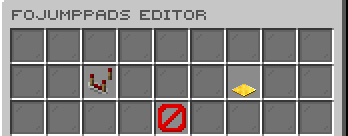
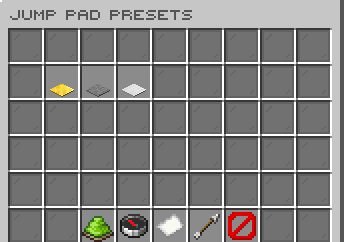

# FoJumpPads

  

Configurable launch pads with reusable presets and administrator tools.

*Developed by Carrotio.*

## Features

- Creates configurable jump-pad presets with launch behavior and effects.
- Lets administrators give, list, teleport to, and remove pads.
- Provides an in-game editor for pad presets and settings.
- Includes configurable safety and landing behavior.
- Keeps messages and interaction sounds configurable.

## Download and dependencies

Download the latest compatible version from [Modrinth](https://modrinth.com/plugin/fojumppads). Check the [versions page](https://modrinth.com/plugin/fojumppads/versions) for supported Minecraft versions and server platforms.

- **Required:** None
- **Optional integrations:** None

## Screenshots

*Open the jump-pad administrator editor.*

*Manage reusable pad presets.*

## Support

For help or issue reports, join the [Carrotio Discord server](https://discord.gg/kEF77QCfu7).

<strong>Commands and permissions</strong>

### Commands

- `/fojumppadsadmin <version|reload|give|list|teleport|remove|editor>` — FoJumpPads admin command. Aliases: `/jumppadsadmin`.

### Permissions

- `fojumppads.admin` — Allows FoJumpPads admin commands and update notices. Default: `op`.

<strong>PlaceholderAPI</strong>

This plugin does not register public PlaceholderAPI placeholders.

<strong>Configuration</strong>

- `config.yml` — Main behavior and feature settings.
- `messages.yml` — Player-facing messages and interface text.
- `sounds.yml` — Configurable interaction sounds.

Main config areas: `settings`, `presets`.

<strong>Developer API</strong>

FoJumpPads exposes a Bukkit service and launch events for other plugins. See [public API source](src/main/java/me/foesio/foJumpPads/api) for contracts and examples.

